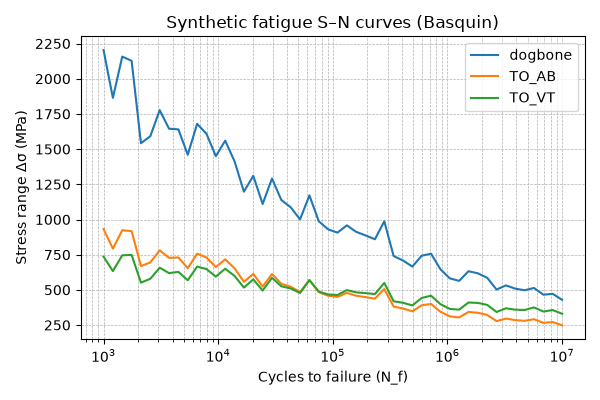
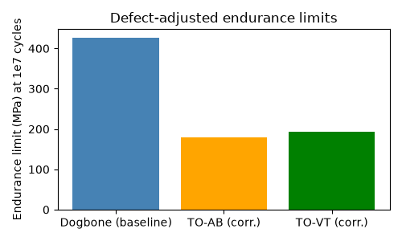

# Verification Results

## Synthetic fatigue curves

## Defect‑adjusted endurance limits (El‑Haddad)

*Baseline endurance (dogbone) ≈  426.5 MPa*
*TO‑AB corrected ≈  178.5 MPa*
*TO‑VT corrected ≈  193.9 MPa*
